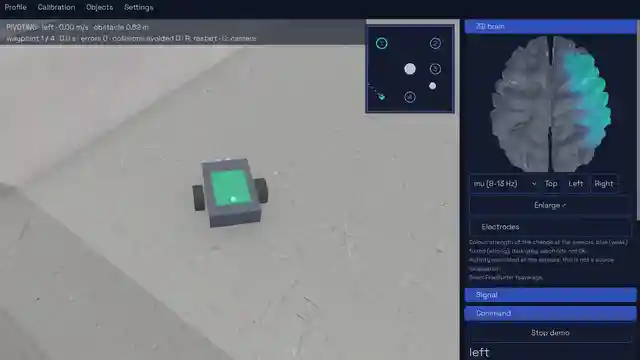
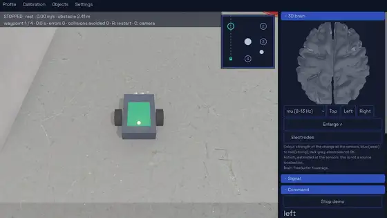
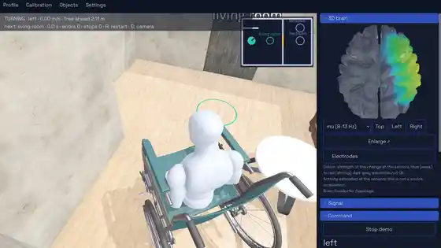
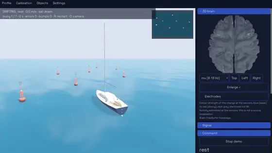
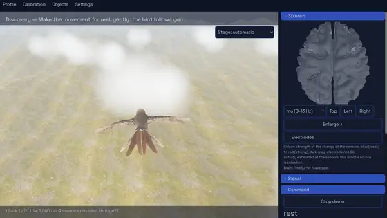
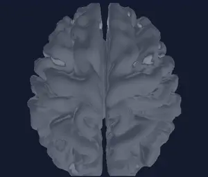

<p align="center">
  
</p>

<h1 align="center">OpenMind Sandbox</h1>

<p align="center">
  <b>Virtual and real objects driven by the mind.</b><br>
  A Godot cockpit, simulators and an ESP32 robot, all speaking the OpenMind protocol.
</p>

<p align="center">
  <a href="https://github.com/openmind-bci/sandbox/actions/workflows/ci.yml"></a>
  <a href="LICENSE"></a>
  
  
</p>

> [!WARNING]
> **Research and experimentation project — not a medical device.**
> OpenMind Sandbox must not be used for diagnosis, treatment, or to drive any
> device that a person depends on.

<p align="center">
  
</p>

The sandbox is where decoded intentions become movement. Every object obeys the
same five generic commands of the
[OpenMind protocol](https://github.com/openmind-bci/core/tree/main/protocol):
`left`, `right`, `forward`, `rest` and `action`. Commands come from
OpenMind Core, from a keyboard simulator, or from the cockpit's built-in demo
decoder, so you can build and test an object **without a headset and without
knowing anything about EEG**.

## Part of OpenMind BCI

```
 ┌──────────────────────────┐     ┌────────────────────────┐     ┌──────────────────────┐
 │  plug                    │     │  core                  │     │  sandbox (this repo) │
 │  any EEG source          │────▶│  intent decoding       │────▶│  Godot cockpit,      │
 │  → standard LSL stream   │ LSL │  → OpenMind commands   │MQTT │  mock and ESP32 robot│
 └──────────────────────────┘     └────────────────────────┘     └──────────────────────┘
```

| Repository | Role |
|---|---|
| [plug](https://github.com/openmind-bci/plug) | EEG source → standard LSL stream |
| [core](https://github.com/openmind-bci/core) | LSL stream → user intent → MQTT commands |
| **sandbox** (this one) | Virtual and real objects driven by those commands |

The sandbox does no EEG processing and no decoding. It depends only on the
`openmind-protocol` package.

## Safety first

Safety lives **on the object side**, so that it holds even if the decoder crashes:

- every object that moves **stops within 2 s** when the decoder heartbeat
  (`openmind/v1/status`) goes silent;
- commands below the object's **confidence threshold** are ignored (one slider
  per command in the cockpit);
- malformed or out-of-order messages are rejected, and the object fails safe.

## The cockpit

`godot/` is a single [Godot 4.5](https://godotengine.org) application: one
window with menus, the object scene on the left and live panels on the right.
**Demo mode** (Ctrl+D) runs a simulated decoder inside the cockpit: no bridge,
no broker, no headset.

<table>
  <tr>
    <td width="50%"></td>
    <td width="50%"></td>
  </tr>
  <tr>
    <td><b>Robot twin</b>: digital twin of the ESP32 robot, built from <code>robot.yaml</code>. Waypoint course, timer, obstacle distance, event log.</td>
    <td><b>Wheelchair</b>: drive through an apartment; <code>action</code> opens the doors.</td>
  </tr>
  <tr>
    <td></td>
    <td></td>
  </tr>
  <tr>
    <td><b>Boat</b>: sail around islands and buoys; <code>forward</code> hoists the sail, <code>action</code> drops the anchor.</td>
    <td><b>Bird</b>: the <b>guided calibration</b>. Cues are sent as markers on MQTT and LSL, so Core can label the training trials.</td>
  </tr>
</table>

### The 3D brain



The brain panel shows, live, where the rhythms of the motor cortex drop:
imagining the left hand lights up the area of C4, the right hand C3, the feet
Cz / CPz. Colours are estimated **at the sensors** from
`openmind/v1/bandpower` and drawn on the FreeSurfer `fsaverage` brain; this is
not a source localisation. Details in [docs/brain-panel.md](docs/brain-panel.md).

The other panels show the scrolling EEG (relayed read-only from Plug), the last
command with its confidence, the progress score and the connection state.

<br clear="right">

## Status

Pre-alpha: everything runs without hardware. See [CHANGELOG.md](CHANGELOG.md).

| Component | Status |
|---|---|
| Local MQTT broker (Mosquitto, Docker) | available |
| Keyboard command simulator and fake band power (`keys`) | available |
| `robot.yaml` and mock robot (`mock-robot`) | available |
| MQTT ↔ WebSocket ↔ LSL gateway (`bridge`) | available |
| Godot cockpit: menus, panels, demo mode, four 3D scenes | available |
| Guided calibration (bird scene) with markers to MQTT and LSL | available |
| Live 3D brain and signal panels | available |
| ESP32 robot firmware (built, not flashed) | available |
| Adapter template for your own object | planned |
| Real robot validation | planned (phase C) |

## Installation

Requires Python 3.11+, [uv](https://docs.astral.sh/uv/), and
[Godot 4.5](https://godotengine.org/download) for the cockpit. Graphic assets
are stored with [Git LFS](https://git-lfs.com).

```bash
git lfs install
git clone https://github.com/openmind-bci/sandbox.git
cd sandbox
uv sync
uv run openmind-sandbox --help
```

The `openmind-protocol` package is installed from the
[core repository](https://github.com/openmind-bci/core/tree/main/protocol).

## Quick start

**Just look around**: open the cockpit and press **Start demo**.

```bash
godot --path godot
```

**Full chain without a headset**: start the local broker (anonymous access,
development only, see [docs/dev-broker.md](docs/dev-broker.md)), the gateway and
a command source.

```bash
docker compose -f dev/docker-compose.yml up -d   # MQTT 1883, WebSocket 9001
uv run openmind-sandbox bridge                   # cockpit gateway on ws://127.0.0.1:8780
uv run openmind-sandbox keys                     # arrows, space for action, q to quit
godot --path godot
```

**Terminal only**: run the mock robot and drive it with the simulator; stop the
simulator and the robot stops within 2 s.

```bash
uv run openmind-sandbox mock-robot
uv run openmind-sandbox keys --script examples/keys-demo.yaml --bandpower
```

| Command | Purpose |
|---|---|
| `openmind-sandbox keys` | Keyboard or scripted command simulator, optional fake band power |
| `openmind-sandbox mock-robot` | Terminal robot that applies the safety rules |
| `openmind-sandbox bridge` | MQTT ↔ WebSocket gateway for the cockpit; scene markers also on LSL |

## Documentation

| Guide | Content |
|---|---|
| [Cockpit](docs/cockpit.md) | Run it, demo mode, scenes, panels, writing a scene |
| [Calibration](docs/calibration.md) | The guided calibration of the bird scene |
| [3D brain](docs/brain-panel.md) | What the colours mean, and what they do not |
| [Bridge](docs/bridge.md) | WebSocket gateway, EEG relay, LSL markers |
| [Keyboard simulator](docs/keys.md) | Commands and band power without a decoder |
| [Objects and mock robot](docs/objects.md) | Safety rules shared by every object |
| [Robot configuration](docs/robot-config.md) | `robot.yaml`, shared by firmware, twin and mock |
| [Firmware](docs/firmware.md) | ESP32 robot firmware |

## Data and privacy

The sandbox never handles EEG. Messages identify users only by pseudonyms
(`P01`, `P02`...), never by name, and everything runs locally.

## Contributing

See [CONTRIBUTING.md](CONTRIBUTING.md). Graphic and sound assets must be CC0 or
under a compatible free license, credited in [ASSETS.md](ASSETS.md).

## License

Code: [Apache-2.0](LICENSE). Assets: see [ASSETS.md](ASSETS.md).
